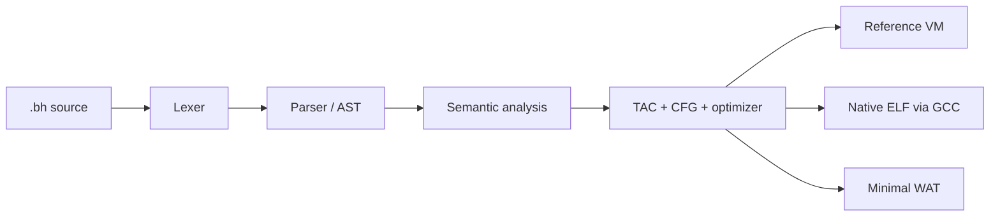

# Bhasha compiler

A readable, hand-written teaching compiler for a small statically typed language with romanised and Unicode Bangla keywords. It has a scanner, LL-style recursive-descent parser, scoped type checker, inspectable TAC listing, and portable reference VM.



```sh
make setup
.venv/bin/bhasha examples/factorial.bh --tokens --ast --tac --run
```

After setup, `make test`, `make coverage`, `make demo`, and `make playground` use the project virtual environment automatically.

Use `make test` for the test suite. The AST VM is the reference execution path; native and WebAssembly backends support the subsets described below.

The `examples/` folder contains ten valid programs (hello, arithmetic, recursive factorial, loops, GCD, conditionals, iterative/recursive Fibonacci, arrays, and multi-function calls) plus lexical/syntax/semantic error inputs.

Native ELF for the supported language subset: `.venv/bin/bhasha examples/factorial.bh -o fact && ./fact`.

The experimental hand-written x86-64 backend can be selected with `.venv/bin/bhasha examples/factorial.bh --direct-x86 -o fact`; this also creates `fact.s`. It supports integer and floating-point arithmetic, scalar input, strings, fixed arrays and functions including recursion and mixed numeric arguments. It lowers the AST directly and does not yet provide complete language or numeric edge-case equivalence.

`.venv/bin/bhasha examples/factorial.bh --tac-x86 -O0 -o fact` selects an experimental **direct TAC-to-x86** backend and writes `fact.s` plus an ELF. Its current subset supports signed 64-bit integer scalars, arithmetic, control flow, globals, recursion, integer input/output and integer parameters passed in registers or on the stack. It explicitly rejects arrays, floating point and non-integer output. `-O1`/`-O2` select optimized TAC; `-O0` selects original TAC. Arithmetic overflow and the signed minimum divided by -1 are not yet equivalent to the Python VM.

`.venv/bin/bhasha examples/factorial.bh --run-tac -O2` executes the optimized inspection TAC. The experimental TAC interpreter supports recursion, arrays and scalar input; it reports unsupported instructions instead of silently skipping them.

For `--run-tac`, `-O0` executes the original TAC and `-O1`/`-O2` use the current optimizer (both currently select the same passes). For GCC-native `-o` and `--asm`, these flags select GCC's corresponding optimization level. The AST `--run` and experimental direct x86 backend do not execute optimized TAC.

Inspect the corresponding GCC-generated System V x86-64 assembly with `.venv/bin/bhasha examples/factorial.bh --asm`.

Export tokens, AST, TAC, optimised TAC, and CFG together with `.venv/bin/bhasha examples/factorial.bh --emit-all build/factorial`.

`--emit-all` additionally writes `program.wat` when the program fits the default WAT subset. `.venv/bin/bhasha program.bh --wat` emits a module whose `run()` returns the final numeric output; it rejects input, printing inside functions and mixed output types.

`.venv/bin/bhasha program.bh --wat-host` emits a module with host I/O, including multiple outputs, string literals, and input. It exports `memory` and `run() -> i32` (which returns zero). The host must provide imports under `host`: `print_i32(i32)`, `print_bool(i32)`, `print_f64(f64)`, `print_string(i32, i32)` (UTF-8 pointer and byte length in exported memory), `read_i32() -> i32`, and `read_f64() -> f64`. The host is responsible for rendering values, reading and validating input, and handling traps. Fixed-size integer, Boolean and float arrays are supported at top level and in local scopes, including recursive functions. Dynamic array sizes and full language parity remain unfinished. A host callback must not re-enter the same instance's `run` while it is active.

WAT integers use 32-bit WebAssembly arithmetic; integer overflow and input range therefore do not have the same semantics as the reference VM's integers.

To run optional WebAssembly execution tests, install `.venv/bin/pip install -e '.[wasm-test]'` and run `make test`; without Wasmtime those tests are skipped.

Start the browser playground with `PYTHONPATH=src python3 -m bhasha.playground`, then visit `http://localhost:8000`.

The playground presents Output, Tokens, AST, TAC, Optimized TAC, an inline SVG CFG plus DOT, optimisation stats, and Diagnostics in tabs.

Playground runs are limited to 100,000 VM steps so an accidental infinite loop returns a diagnostic. The command-line VM has no step limit by default.
